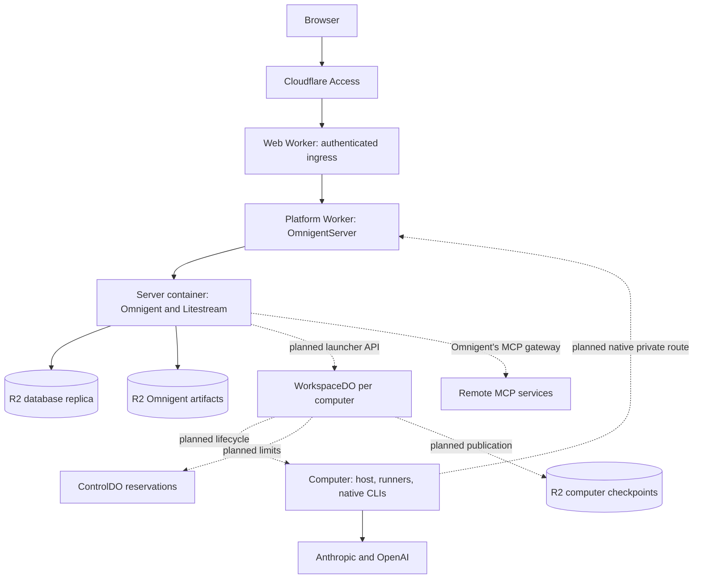

# Architecture

This is the accepted architecture for a single-person Omnigent installation in that person's Cloudflare account. It describes both implemented components and the remaining integration. It is not a deployment-readiness claim. The [decision index](decisions/README.md) records the invariants behind it.

## Source snapshot — 30 October 2026

| Scope | Source revision | Source and qualification status |
| --- | --- | --- |
| Platform main | `main` | Ingress, two Worker configurations, the server controller with its phase-aware startup and recovery watchdog, the server image (pinning fork integration, recording its build identity, credential headers kept out of logs, Omnigent's artifacts in their own bucket), database durability barriers, bootstrap tooling, restore-drill harness and version-one computer contracts. The server's container runs under the `durable_object` scheduling policy on a custom 1 vCPU, 3 GiB, 8 GB instance. Startup of a large database against R2 was measured on `basic`, its earlier size, and is not yet measured on the new one. Artifacts surviving a replacement are tested locally against an S3 stand-in; against R2 they await a staging run. |
| Omnigent fork, 0.20.0 assembly | `212fc5886522931b0e96ffc4f5edc1d5145dd2fa` (`cfo/upgrade-0.20.0`; fork integration `afb809aa6` is 0.19) | Omnigent 0.20.0 with the fork's changes, and explicit runner-replacement capability admission before a new runner launch. Provider-neutral persistent hosts (provisioned by the whole host ID, one sandbox never shared by two hosts), tunnel recovery, operation outcomes, turn checkpoints, launch-token registration, host credential broker, delegated runners, HTTP credential cipher and native-harness continuation fixes. Availability in source does not establish inclusion in an image. |
| Cloud-computer platform | On main: the supervisor modules (`images/computer/cfo_computer/`), the [Cloudflare launcher](../python/cloudflare_omnigent/sandbox/), the controller (WorkspaceDO), ControlDO's limits and reservations, and the container adapter, private routes and fenced backup gateway | The launcher is integrated and registered by the server image, tested against a fake launcher API and Omnigent's own persistent-host flow. The controller is implemented in source: WorkspaceDO and its runtime-free controller, tested in a deterministic simulation (crashes at every commit and call, random event orders). ControlDO's limits and reservations are implemented in source. The assembly is wired in source: WorkspaceDO starts its container through the container adapter with its intercepts registered first, moves workspace layers with the Sandbox SDK's `DirectoryBackup` and writes credential bundles, both through the fenced backup gateway, and its reservation grant carries the installation's size cap. In the Workers runtime the routes, the gateway and ControlDO run against the real WorkspaceDO, which runs against the real ControlDO, with only the container (a simulated supervisor and `sandbox-shim`) and the clocks simulated; the routes were also run on staging against stand-in computers. The computer image has never been deployed, so the assembly is not qualified on Cloudflare. The platform pages (cloud computers, and each computer's setup page with its bridged terminal) are implemented in source and tested in Node, in the Workers runtime against the real WorkspaceDO, both under fakes and assembled (the terminal dialled through the container adapter), and in local browser journeys; they are not deployed or qualified on staging. Signing in to Claude and Codex from the setup page, the computer's status and the staging-only RC-53 and keep-awake switches are implemented in source and tested the same way, with the supervisor's side run against fake CLIs that replay the pinned CLIs' captured login output; no real sign-in has gone through them yet. The staging kill for crash tests is implemented in source and tested in Node and in the Workers runtime; it has not run on Cloudflare. |
| Computer image and supervisor | On main; fork `212fc5886522931b0e96ffc4f5edc1d5145dd2fa` | Built and tested locally: the image, its supervisor as the main process, capture and restore through the computer API with DirectoryBackup's archive, credential checkpoints and sign-out, start attempts and host restarts, including under the 64-character hostname a `durable_object` container gets. The platform Worker's configuration declares it as WorkspaceDO's container. Not deployed yet. See [the computer image](#the-computer-image). |
| Connected accounts (MCP) | On main: the server image's wiring of Omnigent's own MCP registry and gateway, the shipped service manifests, the installer's `services` step and the server's MCP report on the status line ([ADR 0008](decisions/0008-connected-accounts-omnigent-mcp-registry.md)) | Built and tested locally: the image's settings, destination rules and wiring; a local end-to-end run with the platform Worker's real key service, both images and Omnigent's demo OAuth MCP service over HTTPS; the installer's step against the production watchdog and server image. Not yet run on Cloudflare. No platform connection service or connector runtime is planned any more. |

The default [server image](../images/server/Dockerfile) pins the fork's 0.20.0 assembly `212fc5886522931b0e96ffc4f5edc1d5145dd2fa`, Omnigent 0.20.0 merged into `3d7f7d08c`, then fork integration `afb809aa6` and a crash-safe database upgrade merged in, with its F1 (an MCP login the provider rejects is marked "Reconnect needed", WP5.11). It keeps the single-attempt Stop, the provider-key and transcript-replay changes, the main-chat Stop and launch-outcome notices, the history-unavailable resume refusal, and persistent hosts provisioned by the whole host ID. A new runner launch needs a computer of the same release, and the database migrates one way ([the 0.20.0 upgrade](compatibility.md#the-omnigent-0200-upgrade-30-october-2026)). The image records that revision and CI runs the fork's Stop tests against it. Real-platform qualification of this image (a large restore on the target instance against R2) is still pending.

Main [registers the Cloudflare launcher](../images/server/cfo_server/launcher.py) with its replication fence, [enables Omnigent's own GitHub linking](../images/server/cfo_server/app.py) when the installation's GitHub App and the key service's keys are set (see [GitHub linking](#github-linking)), and builds Omnigent's own MCP registry when the installation turns on a service the image ships (see [Connected accounts](#connected-accounts-omnigents-mcp-registry)). The platform Worker has the private virtual hosts' receivers in source ([entrypoints](../worker/src/internal/entrypoints.ts)): `platform.internal` verifies the launcher API's signature, timestamp, operation and protocol version before any effect, and serves the credential store's [key service](../worker/src/internal/key-service.ts); `omnigent.internal` applies the computer route's identity, generation and path rules and forwards natively; `computer.internal` checks the supervisor's messages. The route reads each request's computer identity (generation and bound host) from WorkspaceDO's narrow `identity` call. Runtime qualification of the cloud-computer lifecycle below remains a requirement. Package and experiment evidence does not establish end-to-end cloud-computer readiness.

## Components and flows

Solid lines describe the server-base path or direct CLI model access; dashed lines identify unfinished platform integration. The diagram assigns responsibilities, not measured availability.

| Owner | Responsibility |
| --- | --- |
| Omnigent server | Users, conversations, schedules, approvals, run history, stable host identity and work readiness. Holds waiting work and calls a provider-neutral launcher. |
| Cloudflare launcher | Adapts lifecycle calls to the signed private platform API; waits for database replication before security-sensitive effects. |
| WorkspaceDO | Sole physical-computer authority: generation, start attempts, container, reservation phases, stop records, checkpoint pointers, setup terminal, page sign-in attempts and their lease, and the history of final save outcomes. |
| ControlDO | Installation limits and reservations; no application scheduler or schedule cache. Holds (computer, generation) slots within the awake-computer limit and refuses a wake at the limit at once, without a queue. Gives a slot back only when WorkspaceDO's reservation report shows the container confirmed stopped or its start fenced, and refuses a reservation for a generation its computer has already finished. Never stops, starts or wakes a computer. |
| Web Worker | Public ingress, browser forwarding and platform pages. No application business-state mirror. |
| Platform Worker | Durable Objects, container bindings, private virtual hosts and egress handlers. No public route. |
| Omnigent's MCP registry (in the server) | Connected accounts: the services the installation turned on (the image's manifests and the installation's choices), each account's login in Omnigent's credential store (sealed by the platform Worker's key service), refresh and disconnect, Settings → MCP, and the gateway that calls a service for a runner. There is no platform connection service. |

[Worker configurations](../worker/wrangler.jsonc) and [web configuration](../worker/wrangler.web.jsonc) enforce the deployment split. Frequent web releases keep computer tunnels out of that deployment; browser streams may still drop and reconnect. Platform releases and secret changes are deliberate releases because they can reset live Durable Object connections. Both containers run under Cloudflare's `durable_object` scheduling policy, and an installation creates no `default`-policy container application: Cloudflare refuses to create one on some accounts. A container receives its environment, image and size only when it starts, and a deploy never replaces a running one. A new platform version adopts the running server container, so the server watchdog applies a changed server configuration (a secret, a `SERVER_ENV_` setting, the server image or its size) by replacing an answering server once, through its graceful stop and a restoring start. Each such release therefore costs one short server outage, recorded with the cause `config_changed`; a release that leaves all of them unchanged restarts nothing. Wrangler pins each deployed image by digest, and the watchdog compares digests, so a rebuild of unchanged sources restarts nothing only when it reproduces the same image. An installation takes a newer release with `bootstrap.ts update` (built and tested in source against a fake Cloudflare, not yet run on Cloudflare): from a clean checkout it deploys the platform Worker and then the web Worker with the plan's own names and settings, keeps every secret (Wrangler's deploy inherits them) and adds only those the release needs and the Worker lacks. Each of its platform deploys sets a `SERVER_ENV_` deploy ID of its own, so every update restarts the server once, on purpose, and the installer checks the restarted server: the objects run the new version, and a server started with it answers and shows the owner initialized and durable. Every update also follows [ADR 0007](decisions/0007-compatible-releases-recovery.md) (WP3.41, built and tested locally, not yet run on Cloudflare): the deploy carries a read-only window, a secret under which OmnigentServer passes no request to the server, `platform.internal` starts no computer and the server runs no scheduled task, and names a restore point, which the new server copies from the replica, beside it in its bucket, before Omnigent and its migrations start. Once the check passes and the restore point is reported, the installer deletes the window's secret (accepted), which restarts the server once without it; until then `update --rollback` puts the restore point back and deploys both Workers' previous versions again. The server stays up: Cloudflare stops a container shortly after its Durable Object becomes inactive unless an inactivity timeout (at most 6 hours) is set, and the watchdog's check every minute renews a one-hour timeout. [ADR 0002](decisions/0002-two-workers-native-transport.md) explains native forwarding and its remaining qualification.

## Boundaries that must survive implementation

**Access and authority.** The installer creates the hostname's owner-only Access application before anything is deployed, and never changes one it did not create ([Access application](operations/recovery.md#access-application)). Public requests pass assertion validation, identity pinning, hostname and exact-origin checks before forwarding. The [origin check](../worker/src/ingress/origin.ts) requires the exact origin on unsafe methods and WebSocket upgrades whose `Origin` is present; GET, HEAD and OPTIONS are exempt because they are meant to change nothing. One forwarded Omnigent route does change state on GET: `GET /auth/magic/redeem` consumes a one-time sign-in token and sets a session cookie, and SameSite=Lax does not stop a top-level cross-site navigation to it. Exploiting it needs a valid magic token for this installation. Treat that route as a state change: never retry it automatically, and do not add other state-changing GET routes behind the exemption. Private virtual hosts are registered by container interception, not exposed as public routes. The server signs launcher and key-service calls with separate HMAC credentials. Computer interception binds computer identity and generation and applies the route restrictions. A computer has broad delegated owner-equivalent reach in Omnigent, including access to other computers' work; it is not a narrowly isolated tenant. Approval, account, policy and identity restrictions are described precisely in [ADR 0004](decisions/0004-identity-credential-authority.md).

**Platform pages.** The web Worker serves the platform's own pages under `/platform/`, after ingress, and never forwards that path to Omnigent. Every answer denies framing (`frame-ancestors 'none'`, `X-Frame-Options: DENY`) and carries a script policy that allows only this origin. A GET never changes state; a control link shows a confirmation page. A change is a POST whose `Origin` is exactly the installation's origin, with same-origin fetch metadata when the browser sends it and a request-intent token for the owner's Access session, which the computer's WorkspaceDO checks in constant time before any effect. The setup terminal is a WebSocket bridged inside WorkspaceDO to the computer's ttyd: each stream needs a single-use capability bound to the owner, the Access session, its purpose, the computer, its generation and the terminal window, presented as a WebSocket subprotocol rather than in a URL. A window lasts at most 30 minutes, and its streams close at the deadline, on removal, on a new generation and before a restart, a stop without saving or a sign-out. Each window's shell runs in its own tmux session on the computer, so a stream that drops, even with WorkspaceDO's own instance reset or its link to the computer cut, reconnects to the same shell: the first stream of a window starts the session and WorkspaceDO records that it did; every later stream may only attach to it. A reconnect whose shell is gone is told so (close code 4002) and never given a new shell in its place, so a code pasted for a sign-in prompt cannot run as a command; a reconnect while the old browser stream still looks attached takes the stream over. Every way a window ends also ends its session on the computer (WorkspaceDO sends `terminal_end` until the supervisor answers), and the supervisor ends every session itself before a sign-out, a stop's final save and a sign-in from the page, and reaps a session left without a stream for 45 seconds or older than 30 minutes. The session's tmux socket belongs to the person's account, so code running on the computer as that account (an agent) can attach to it, as it could already read or trace the shell; agents are not restricted on their own computer. Terminal traffic is never logged; close codes are logged as numbers, and no HTML or script from a computer is served on the installation's origin: the page's terminal emulator (xterm.js) is served by the web Worker. While a window is open the computer does not sleep.

**The owner's password page.** The owner chooses the Omnigent password on the site, not in the installer: the installer gives the server a random starting password nobody sees, so the owner's account exists from the first start (Omnigent never offers its first-visitor setup) but nobody can sign in as the owner until they choose one. `/platform/password` is that page, and the owner's "forgot password" page: after ingress, a form with the username and the password twice, posted with the same exact-origin, fetch-metadata and request-intent checks as every platform change (the intent token here is OmnigentServer's, bound to the Access session). While the owner has no password yet, the web Worker sends the owner's page loads to it. OmnigentServer limits the attempts (6 in 10 minutes), then makes a signed platform call to the server container's port 8000 (`POST /_cfo/owner-password`, keyed by a key derived from Omnigent's cookie secret, accepted once within 60 seconds); OmnigentServer never forwards `/_cfo/` for a browser or a computer. The server image's handler runs Omnigent's own password change on the installation's named owner, which ends every older session of the owner, and the response barrier answers only once the change is replicated; the page says "done" only then. A server that is starting, restoring or in recovery mode gets "try again", never a silent no-op. The page and its checks are implemented in source and tested in Node, in the Workers runtime through the real ingress and OmnigentServer, and against the server image's real Omnigent; they are not yet deployed or qualified on staging. See [secret custody](secrets.md#the-owners-password).

**Signing in from the page.** Every everyday owner action has page controls; the terminal is for debugging, and the fallback when a sign-in from the page fails or the computer's software predates it. Each sign-in card has a button:

- **Claude.** The computer's supervisor runs the unmodified `claude auth login --claudeai` in a pseudo-terminal, as the computer's user with the terminal's environment, and reads Anthropic's link from its output. The page shows the link and a field for the one-time code Anthropic gives; WorkspaceDO relays the code to that CLI and to nothing else.
- **Codex.** The supervisor runs `codex login --device-auth`; the page shows OpenAI's link and the one-time device code, links to ChatGPT's setting that turns device-code sign-in on, and waits.
- **Links.** A link reaches the page only if it is HTTPS on exactly the host and path the pinned CLI uses (`claude.com/cai/oauth/authorize`, `auth.openai.com/codex/device`). Anything the parser does not know fails the attempt, and the page offers the terminal.
- **Completion** is the CLI's own. The credential watcher saves the new login file, as after a terminal sign-in, and the card turns "Signed in". The platform still never reads a login file.
- **Fenced attempts.** WorkspaceDO numbers each attempt and binds it to the computer, its generation, the service and the Access session that started it. A newer start ends the older one; input, cancel and status act on their own attempt only. A cancel is recorded before it is sent, so a start still in transit never begins after it; the supervisor keeps a per-service fence for the same rule. Every ended attempt's process group is killed and reaped before the terminal is offered.
- **The sign-in lease.** An active attempt keeps the computer awake and defers the start deadline, as an open terminal does. It is bounded by the attempt's 10-minute platform deadline and expires on its own. A stop, a sign-out or a removal closes admission and cancels every attempt before its credential steps.
- **Never kept.** The link, Codex's device code and the pasted code are never written to a log, Durable Object storage, the computer's files or a save: the supervisor holds them in memory for the attempt's life, WorkspaceDO only on the request path.

**Computer status.** The setup page shows the computer's status, composed in WorkspaceDO: the supervisor's metrics (the CLIs' versions and sign-in states, whether the hostname resolves, disk, its alerts by kind), the saved login checkpoint (all four declared files, present or tombstoned), the sign-out's phase, and WorkspaceDO's own history of final save outcomes with RC-53's counts. `tombstoned` and `verified` are labelled for what they prove: a published checkpoint, or a read-back of the stored copy, holding tombstones. Neither is a restore into a fresh computer, nor revocation at the provider. The cloud-computers list marks a computer whose last save failed. While a computer runs, WorkspaceDO logs the status as `computer_status` every five minutes and on each change; what it last logged is kept in its storage, so a new instance does not log an unchanged status again. Like the status, the log holds names, versions, outcomes, reasons and counts only. A sign-out run's phase follows its own snapshot of the logins: a checkpoint published while the CLIs log out one after the other (one login already removed, the other not yet) does not undo it, but it does take back an earlier `tombstoned` or `verified` until the run's own tombstones are published and read back again.

**Instance starts.** WorkspaceDO, OmnigentServer and ControlDO each log `instance_started`, with a random instance ID, whenever a new instance of the object starts. A reset, an eviction or a version switch therefore shows in the logs, with the Worker version that started it. OmnigentServer's `upgrade` and `first_alarm` lines and the setup terminal's lines carry the same ID, so a reconnect is tied to the instance that answered it.

**Wake measurements.** WorkspaceDO logs each container `start()` attempt (`container_start`), each start Cloudflare refused and it retried (`start_retry`), and each confirmed stop (`stop_confirmed`, besides `unexpected_stop`); the launcher API's call lines name the computer and the call's length. With ControlDO's grants and the computer route's tunnel opens, a computer's wake time and the gap between a stop and the next start can be read from the logs alone. These lines hold names, numbers and reasons only.

**The RC-53 save check** is a staging-only switch. It is shown, and accepted, only on an installation the bootstrap marked as staging (`CFO_STAGING_INSTALLATION`, set for staging targets only). WorkspaceDO keeps the desired state and applies it again in every generation before its captures. While the computer is not running, the page says the switch takes effect when it next starts.

**Keep awake** is a second staging-only switch, beside it, for soak tests. While it is on, WorkspaceDO refuses Omnigent's `suspend` as it does while the setup terminal is open, in every generation, until it is turned off; Omnigent otherwise puts a computer to sleep after five minutes with no live runner. It is persisted and shown in the status, and refused on production like the RC-53 switch.

**The staging kill** is a staging-only control for crash tests, used only by the staging harness, never by a page: WorkspaceDO's `stagingKill` destroys the computer's container at once (the runtime's `destroy()`, a SIGKILL, through the container adapter), with no stop intent, no save and nothing written, as a crash or platform maintenance would. WorkspaceDO then finds the container gone at its next heartbeat and records an unexpected stop, and the next wake restores from the last published checkpoint. Like the two switches, it is refused, before anything happens, unless the bootstrap marked the installation as staging.

**Credential custody.** Worker-held encryption keys do not prevent plaintext credentials from being used by the server. The server needs cookie, replication, artifact-storage and bridge credentials; Omnigent's GitHub linking also needs its GitHub App's client ID and secret and the key service's signing key. Omnigent's MCP gateway holds connected accounts' logins in the server's memory while it calls or refreshes them; the database holds them only as ciphertext, and they never reach a computer. Computers hold Claude/Codex login files, launch tokens in memory/environments, delegated runner tokens and, with native GitHub linking, a GitHub access token while git/gh uses it. Codex provider keys can occupy a mode-0600 reference file excluded from workspace checkpoints. A user account is not a boundary inside a container: under the `durable_object` policy every process has root's Linux capabilities, whatever user it runs as. The server image runs every process as root and limits each one's credentials to what its environment receives; a computer's account already has passwordless sudo. Workspace and credential checkpoints deliberately have different content and publication rules. Checkpoint buckets contain sensitive login material; version one relies on private Worker bindings and R2 encryption at rest, without application-level checkpoint encryption. Every workspace layer and credential bundle reaches the bucket through the platform's [backup gateway](../worker/src/egress/backups.ts), which asks the computer's WorkspaceDO before each write and refuses a removed computer, another generation or a key outside the computer's own prefix. WorkspaceDO reads and deletes in the bucket directly; it never writes there except through the gateway (assembled in source; not yet run on Cloudflare).

**Durability.** The server container's disk does not survive a replacement or a release's controlled restart. Litestream replicates the database to its R2 bucket, and Omnigent's S3 artifact store keeps uploaded files, session resources and agent bundles in a separate R2 bucket; the server image refuses to start without that bucket rather than keep them on the disk (the switch that allows the disk is for tests). Each process gets only its own bucket's credentials. An upload is written to the bucket before Omnigent answers it; its database row is replicated like any other write. The bucket is not restored with the database: see [uploaded files](operations/recovery.md#uploaded-files). Three separate barriers protect security responses, transcript acknowledgements and launcher effects. A `424 durability_unconfirmed` says a change was applied but replication is unconfirmed; it must not trigger a blind retry. A retryable transcript acknowledgement uses stable identifiers and has different semantics. Neither barrier makes a computer capture published. See [ADR 0003](decisions/0003-durability-before-acknowledgement-effect.md) and [ADR 0005](decisions/0005-checkpoint-publication-continuation.md).

**Lifecycle.** Admission closes before quiescence and durable launch-token revocation; only then may suspend checkpoint and stop. Unknown suspend outcomes keep admission closed and reconcile under the same operation ID. A live host reconnects with its current token; a new start requires a granted start attempt. Reservations are released after confirmed stop or fenced abandonment. Capacity pressure does not authorize stopping another computer. The installation sets its limits with the platform Worker's `CFO_MAX_AWAKE_COMPUTERS` (default 2) and `CFO_MAX_INSTANCE_SIZE` (default `standard-4`); an invalid value makes wakes fail visibly rather than fall back to a default. Each reservation grant carries the size limit as it is then, so a computer never starts above it, even when a separate read of the limits is lost. Once a computer has a removal intent, every launcher call but `terminate` answers `gone`, a sleep included. See [ADR 0001](decisions/0001-omnigent-owns-host-execution.md).

**Recovery and honest outcomes.** Lost replies can leave effects uncertain. A replacement runner must not automatically replay an uncertain turn. Stop is forwarded once and reports delivery uncertainty. Restoring files does not roll back external actions. Artifact identity, version checks, maintenance windows and authority invalidation after destructive recovery are part of [ADR 0006](decisions/0006-honest-uncertain-outcomes.md) and [ADR 0007](decisions/0007-compatible-releases-recovery.md).

## GitHub linking

Omnigent's own GitHub linking is on in this installation (owner decisions D22 and D37), for GitHub only: no other Omnigent credential provider is configured.

- **The App.** Each installation has its own GitHub App. `bootstrap.ts github-app` registers it through GitHub's manifest flow: it serves a one-time page on the installer's computer that posts the App's manifest to GitHub, the owner clicks "Create GitHub App", and the code GitHub returns is exchanged for the App's ID, slug, client ID and client secret, which go straight into the platform Worker's secrets. The App asks for repository contents and pull requests (read and write) and metadata (read), has no webhook, can be installed only on the account that created it, and calls back to `https://<hostname>/v1/connections/github/callback`, behind Access. GitHub's answer also carries the App's private key and webhook secret; neither is kept, since Omnigent's linking uses neither and the private key would let its holder act as the App on every repository it is installed on.
- **Setup without dead ends** (WP3.36). The App's settings reach the server only when it starts, so after storing them the installer waits until a server started with them reports GitHub linking on, and only then sends the browser to GitHub's install page. What it waits for is the watchdog's status line in Workers Logs, which names the App the logging version holds (a short tag of its client ID, so that the evidence is this App's, never an earlier one's) and says whether Omnigent's `/v1/info` lists `github` in `enabled_connections`, the very list that makes Omnigent's interface show its Integrations settings. A configuration error (exit 78) counts only when the watchdog says the configuration it holds is the current one, with this App, and the newest such word decides: a later status of another App, or a replacement begun, overrides an earlier verdict. The step also checks first that both Workers run a release with the setup flow (`CFO_PLATFORM_FEATURES` and `CFO_WEB_FEATURES`). The platform Worker's cron, which runs on the newest version at once, sends the server's object the fingerprint of the server environment its version would start; an object still on an older version (for up to about 5 minutes after a secrets change) resets itself so that its next instance applies the new configuration: never twice in a row for the same newer environment, and at most once in 10 minutes. The App's setup URL is the installation's GitHub setup page, `/platform/github`, behind Access and the owner pin like every platform page: it changes nothing, ignores what GitHub appends, opens Omnigent's Integrations page once a server started with this version's settings reports GitHub linking on, waits (reloading itself, no script) otherwise, and after 15 minutes says what is wrong. The installer's local page waits an hour for "Create GitHub App" and then says, for a while, that its link expired.
- **Linking.** The owner installs the App on their account (GitHub's install page, which the installer opens once GitHub linking is on) and then chooses Connect GitHub in Omnigent's settings, which the setup page opens. Omnigent stores the owner's user token set (an access token for up to 8 hours and a refresh token) in its credential store. Unlinking deletes the record. Every write to the record (linking, relinking, a token refresh, unlinking) is answered only once the database replica holds it (the response barrier), so a restore never undoes one; while the replica is blocked, a request that refreshed the token is answered `424` once and the next one succeeds.
- **The key service** ([`worker/src/internal/key-service.ts`](../worker/src/internal/key-service.ts)). Omnigent's credential store encrypts through core change 19's HTTP cipher, which calls the platform Worker on `platform.internal/key-service/v1`. Since WP5.10 the installer makes its keys at install (and `update` adds them to an older installation), and the server image turns the cipher on whenever its signing pair is set, with or without GitHub: it also seals the MCP services' logins (below). Only the server container has that intercept. Each request carries an HMAC-SHA256 signature over a protocol line, the operation, the signing key's ID, a timestamp and the body's hash; the Worker checks it in constant time before reading the body, refuses a timestamp more than 300 seconds from its clock, then checks the body. It seals each record with AES-256-GCM under a key derived by HKDF-SHA256 from a versioned 32-byte root key and the record's identity (workspace, user, provider and account), so a record opens only under its own identity, key ID and version. A wrong identity or a corrupt record reads as "not linked"; any other failure is an outage, which keeps the record rather than letting a reconnect overwrite it (the host's broker still tells a computer "not linked" until the service answers again). The root keys are a Worker-only secret that no container receives; the server holds only the signing key. The protocol has no nonce: a captured request can be replayed only within the window, only to its own operation, and only from the server container. Without its keys the service refuses everything. It never logs a body, a context, a key ID or a plaintext.
- **Custody.** The database and its R2 replica hold only ciphertext; opening a record needs the Worker. The server uses the plaintext token set to refresh tokens and to answer its host-credentials endpoint, whose only GitHub caller is a computer's host, authenticated by its launch token. The refresh token never leaves the server.
- **On a computer** (core change 17). The host serves a credential broker on a local socket in a runtime directory outside the home and the workspace. git's credential helper for `github.com` names only that socket, and gh runs through a wrapper that asks the same socket and passes the token as `GH_TOKEN`. The broker asks the server for each request, so the access token is in memory while git or gh uses it, and never in `~/.gitconfig`, gh's `hosts.yml`, an argument or a save. Unlinking stops new tokens at once; a token already handed out stays valid at GitHub until it expires (up to 8 hours). Any process on the computer can ask the broker while the host runs: the owner accepted that agents on their own computer can use their GitHub access.
- **Settings.** The server image turns linking on when, and only when, the App's client ID, client secret and redirect URI and the key service's signing pair are all set; then it passes exactly those (with the App's ID and slug and the key service's URL, which must be on `platform.internal`) and pins the cipher to the key service. A half-configured App is off with a warning; a malformed value stops the start. The [secret inventory](secrets.md) lists the names and their rotation.
- **Status.** Built and tested in source: the key service against the fork's test vectors in the Workers runtime, the server image's settings and wiring, the installer's manifest flow against a fake GitHub, and a local end-to-end test (the Worker's key service under `wrangler dev`, the server image, a computer image's real host, git and gh, and a fake GitHub). The setup flow (the wait for GitHub linking, the setup page, the object's yield to a newer version) is tested in the Workers runtime and against the installer's simulated Cloudflare. Not yet run on Cloudflare or with a real GitHub App; in particular, that a reset object's next instance runs the newest version at once is Cloudflare's behaviour still to be observed there.

## Connected accounts: Omnigent's MCP registry

Connected accounts are Omnigent's own MCP registry and gateway, switched on by the platform ([ADR 0008](decisions/0008-connected-accounts-omnigent-mcp-registry.md), owner decision D43). The platform adds no gateway, connection service or approval layer of its own.

- **The gateway.** Omnigent's server holds each account's login and calls the remote MCP service itself (`POST /v1/mcp/{service}`, Streamable HTTP, a fresh connection per call, redirects refused). Runners get service references and tool schemas, never a URL or a token. Each call passes Omnigent's checks in order: the caller, its edit access to an active session, the service selected for the session, the registry's and the session's tool allowlists, and Omnigent's tool-call and tool-result policies as they are. A call cut by a transport failure ends as "completion unknown" and is never replayed.
- **Which services.** A service is one Omnigent registry entry, shipped in the server image as a manifest (`images/server/services/<id>.json`, reviewed and released with the code), with a tool allowlist and the list of what the installer must ask for (`asks`: the service's origin, an OAuth client's ID and secret). Nothing in a manifest is about approvals. Version 1 ships Omnigent's demo OAuth MCP service as the test service (it asks for the origin it runs at) and GitHub's MCP server through Omnigent's GitHub link (`auth: github`). The installation stores only its choices, as Worker secrets that reach the server (`CFO_MCP_SERVICES` and each service's asked values, [secret inventory](secrets.md)); at each start the image checks them, builds Omnigent's registry configuration (with the installation's own URL for OAuth callbacks) and passes the registry to `create_app`. Settings → MCP appears when `/v1/info` lists `mcp`.
- **Destination rules.** On every URL the server calls or sends a browser to: `https` only; a public host name (no IP literal, `localhost`, `.internal` or `.local` host, a real top-level domain); no user name, password, query or fragment. A manifest or choice that breaks one, or any other malformed choice, stops the server's start with exit 78 and a `config.error` line that names the setting, never its value; a missing prerequisite (the key service's keys, the OAuth state secret) turns MCP off with a `config.warning` line instead. A name that resolves to a private address is not caught: only the installer chooses origins.
- **Custody.** Logins are rows of Omnigent's `connections` table (provider `mcp:<id>`), sealed by the platform Worker's key service as GitHub's are; the database and its R2 replica hold only ciphertext. Every write to them (connect, refresh with a rotated refresh token, disconnect) is answered only once the replica holds it, so a restore never brings back a spent refresh token. Plaintext exists only in the server's memory during a call or a refresh. No endpoint returns a token; generic MCP logins are never vended to a host. OAuth client secrets are Worker secrets only the server receives; Omnigent's OAuth state is signed with its own state secret, made at install.
- **Connecting and disconnecting.** The owner connects, tests and disconnects accounts in Omnigent's Settings → MCP, or from a new conversation's MCPs picker; the provider's sign-in comes back to Omnigent's callback on the installation's own address, behind Access. Disconnect deletes the login, and the next call fails at once; a call already authorized may finish, and the provider's own grant stays until it is removed on the provider's site. A login the provider rejects (a 401 to its access token, or `invalid_grant` at a refresh) is marked: Settings → MCP and the picker show "Reconnect needed", the next call refreshes first (nothing is replayed), and a fresh connect clears the mark.
- **Turning a service on or off** (`bootstrap.ts services add <id>` or `remove <id>`, run by the person who installed). The step checks the release and the keys, asks in the terminal for what the manifest asks (secrets never shown), checks the destination rules first, stores the list, the values and a new revision in one secrets change, and waits until a server started with that revision answers: the watchdog's status line says which revision its version holds (`mcpRevision`) and whether Omnigent's `/v1/info` lists `mcp` (`mcpRegistry`), the GitHub step's channel. It then says "Ready. Connect it in Omnigent: Settings → MCP", or what is wrong (off, held with the way back, not yet). Each change restarts the server once.
- **Computers.** A computer reaches the gateway through its private route like every other Omnigent call; the route's block list does not cover `/v1/mcp`. Omnigent refuses a runner's delegated token only under `/auth` and `/oauth`, so code on a computer can also list the catalog and disconnect or replace one of the owner's logins (never read one): accepted by the owner with the rest of an agent's reach on its own computer (decision D44, [security calibration](operations/security.md)), so the route blocks none of those endpoints.
- **Status.** Built and tested in source: the image's settings, destination rules (one set of vectors for the image and the installer) and wiring, coupled to the pinned Omnigent's names and models; the app in process with a loopback key service and the demo service (connect, ciphertext only, a runner's calls with the runner's own client, a refresh, disconnect); a local end-to-end run with the platform Worker's real key service under `wrangler dev`, the server and computer images and the demo service over HTTPS, with a canary scan of the computer, of what a checkpoint of it would hold and of every log; and the installer's step against the production watchdog and server image. Not yet run on Cloudflare: the callback through Access, the computer's private route to the gateway, a drop or deploy during a call, and GitHub's MCP server with the GitHub App's user token.

## The computer image

Each cloud computer runs one container of the [computer image](../images/computer/Dockerfile): Omnigent's host built from the fork, Claude Code and Codex exactly as published at pinned versions, gh behind the host's credential-broker wrapper, the Sandbox SDK's `sandbox-shim` for `DirectoryBackup`, ttyd and tmux for the setup terminal, and the supervisor ([`cfo_computer`](../images/computer/cfo_computer/), standard library only). The person's account is `omnigent` (uid 1000, workspace `~/work`, passwordless sudo: agents are not restricted on their own computer); the supervisor and its pause guard run as root.

- **Main process.** tini is PID 1 and the supervisor its only child, so the supervisor's death ends the container. The workload (the host, the setup terminal, the CLIs the supervisor runs, including a sign-in's login in its own pseudo-terminal and session) runs as the person's account, in its own sessions, with an environment built from an allowlist: no platform, GitHub App, Databricks or credential-key variable reaches it.
- **Computer API.** The supervisor serves WorkspaceDO's commands on port 8090 and sends its messages to `computer.internal`. It parses every command with the exported contract schemas plus the zod refinements, refuses another protocol version, computer or generation before any effect, and records answers by operation ID.
- **Order.** Workspace restore, then the credential install, then the host: a start attempt before both is declined for good. A host that exits is restarted with the same launch token, held in memory only, except Omnigent's "token refused" exit, which parks it until a newer attempt.
- **Capture.** An unpaused copy into a kept snapshot, then a pause under a lease guard (the cgroup freezer where the cgroup filesystem is writable, SIGSTOP otherwise) of everything below init except the supervisor and its helpers, one policy scan and a byte-for-byte copy, then resume; the layer is staged afterwards. Processes the platform starts with `exec` are outside the pause; nothing that writes the workspace may run that way.
- **Restore.** Layers restored by `DirectoryBackup` are checked against their own index and the manifest's digests, merged in a staging directory, stripped of anything the checkpoint policy does not save, checked against the index, and moved into place; a failure leaves the home as it was.
- **Credentials.** Only the four declared files travel, in whole numbered snapshots with tombstones, never while a writer holds one open. Each CLI's own status command reports sign-in state; sign-out runs each CLI's logout, which cannot prove revocation at the provider.

These are built and locally tested behaviours of this image. Cloudflare's disk, cgroupfs and capabilities, R2 through the platform's gateway, WorkspaceDO's side of the lifecycle and real sign-ins still need runtime qualification.

## Contract and qualification authority

[TypeScript contracts](../contracts/src/index.ts) define wire schemas and runtime refinements; exported JSON Schema is a cross-language projection. The [lifecycle table](../contracts/src/lifecycle.ts), [checkpoint policy](../contracts/src/checkpoint-policy.ts), fixtures and [vectors](../contracts/vectors/) define their respective behavior. A schema-only pass does not cover refinements omitted by export. Actual launcher, controller and supervisor parsers must consume the matching valid, invalid, refined and signing/policy cases; packaging must include the correct assets.

Existing [contract tests](../contracts/test/m3.test.ts), [Python fixture/vector tests](../python/tests/test_contract_vectors.py), [server image tests](../images/server/tests/) and [Worker tests](../worker/test/) are source references, not a claim that all production receivers or assembled images pass them. Release evidence must identify source revisions, artifact contents and runtime conditions separately.
