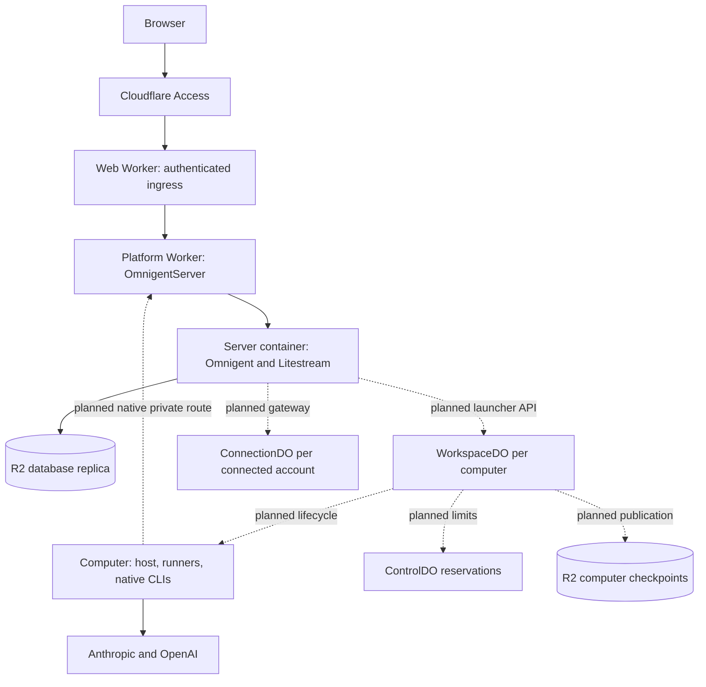

# Architecture

This is the accepted architecture for a single-person Omnigent installation in that person's Cloudflare account. It describes both implemented components and the remaining integration. It is not a deployment-readiness claim. The [decision index](decisions/README.md) records the invariants behind it.

## Source snapshot — 24 October 2026

| Scope | Source revision | Source and qualification status |
| --- | --- | --- |
| Platform main | `91261d7e8fe4b87c8010d50739cd921dd4bf09fe` | Ingress, two Worker configurations, server controller and image definition, database durability barriers, bootstrap tooling, restore-drill harness and version-one computer contracts. |
| Server candidate | `eb26816c150bb62c2ecc3222991769738b220afb` | Startup/recovery watchdog corrections, image build-identity support and logging corrections. Separate from main; basic-instance startup against R2 remains pending qualification. |
| Omnigent fork integration | `184b5cf8b32815b48c7859973a00a139e8aa50f0` | Provider-neutral persistent hosts, tunnel recovery, operation outcomes, turn checkpoints, launch-token registration, host credential broker, delegated runners, HTTP credential cipher and native-harness continuation fixes. Availability in source does not establish inclusion in an image. |
| Cloud-computer platform | Supervisor modules on main (`images/computer/cfo_computer/`); controller `61d3cab`, routes/harness `cb2fe85`, launcher `dc76868` as drafts | Partial. The complete controller/routes/image/launcher assembly is not integrated or qualified. Limits and platform pages remain planned. |
| Computer image and supervisor (25 October) | Branch `wp/3.4-computer-assembly`; fork `184b5cf8b32815b48c7859973a00a139e8aa50f0` | Built and tested locally: the image, its supervisor as the main process, capture and restore through the computer API with DirectoryBackup's archive, credential checkpoints and sign-out, start attempts and host restarts. Not deployed; no WorkspaceDO drives it yet. See [the computer image](#the-computer-image). |
| Connected-account gateway | Planned | Worker connection service and connector runtimes, including the later platform GitHub path. |

The default [server image](../images/server/Dockerfile) pins fork integration `184b5cf8b32815b48c7859973a00a139e8aa50f0`, which includes the single-attempt Stop, the provider-key and transcript-replay changes, the main-chat Stop and launch-outcome notices, and the history-unavailable resume refusal. The image records that revision and CI runs the fork's Stop tests against it. Real-platform qualification of this image (a large restore on the target instance against R2) is still pending.

Main currently registers a [launcher placeholder](../images/server/cfo_server/launcher.py), [disables native GitHub linking](../images/server/cfo_server/app.py), and [refuses `platform.internal` requests](../worker/src/server/platform-internal.ts). Thus the launcher effect fence, Worker key service and cloud-computer lifecycle below remain integration requirements. Package and experiment evidence does not establish end-to-end cloud-computer readiness.

## Components and flows

Solid lines describe the server-base path or direct CLI model access; dashed lines identify unfinished platform integration. The diagram assigns responsibilities, not measured availability.

| Owner | Responsibility |
| --- | --- |
| Omnigent server | Users, conversations, schedules, approvals, run history, stable host identity and work readiness. Holds waiting work and calls a provider-neutral launcher. |
| Cloudflare launcher | Adapts lifecycle calls to the signed private platform API; waits for database replication before security-sensitive effects. |
| WorkspaceDO | Sole physical-computer authority: generation, start attempts, container, reservation phases, stop records, checkpoint pointers and setup terminal. |
| ControlDO | Installation limits and reservations; no application scheduler or schedule cache. |
| Web Worker | Public ingress, browser forwarding and platform pages. No application business-state mirror. |
| Platform Worker | Durable Objects, container bindings, private virtual hosts and egress handlers. No public route. |
| ConnectionDO | Planned connected-account custody, refresh/revocation and operation journal. |

[Worker configurations](../worker/wrangler.jsonc) and [web configuration](../worker/wrangler.web.jsonc) enforce the deployment split. Frequent web releases keep computer tunnels out of that deployment; browser streams may still drop and reconnect. Platform releases and secret changes are deliberate releases because they can reset live Durable Object connections. [ADR 0002](decisions/0002-two-workers-native-transport.md) explains native forwarding and its remaining qualification.

## Boundaries that must survive implementation

**Access and authority.** Public requests pass assertion validation, identity pinning, hostname and exact-origin checks before forwarding. Private virtual hosts are registered by container interception, not exposed as public routes. The server signs launcher and key-service calls with separate HMAC credentials. Computer interception binds computer identity and generation and applies the route restrictions. A computer has broad delegated owner-equivalent reach in Omnigent, including access to other computers' work; it is not a narrowly isolated tenant. Approval, account, policy and identity restrictions are described precisely in [ADR 0004](decisions/0004-identity-credential-authority.md).

**Credential custody.** Worker-held encryption keys do not prevent plaintext credentials from being used by the server. The server needs cookie, replication and bridge credentials; the planned native GitHub integration also needs its GitHub App configuration. Computers hold Claude/Codex login files, launch tokens in memory/environments, delegated runner tokens and, with native GitHub linking, a GitHub access token while git/gh uses it. Codex provider keys can occupy a mode-0600 reference file excluded from workspace checkpoints. Workspace and credential checkpoints deliberately have different content and publication rules. Checkpoint buckets contain sensitive login material; version one relies on private Worker bindings and R2 encryption at rest, without application-level checkpoint encryption.

**Durability.** Three separate barriers protect security responses, transcript acknowledgements and launcher effects. A `424 durability_unconfirmed` says a change was applied but replication is unconfirmed; it must not trigger a blind retry. A retryable transcript acknowledgement uses stable identifiers and has different semantics. Neither barrier makes a computer capture published. See [ADR 0003](decisions/0003-durability-before-acknowledgement-effect.md) and [ADR 0005](decisions/0005-checkpoint-publication-continuation.md).

**Lifecycle.** Admission closes before quiescence and durable launch-token revocation; only then may suspend checkpoint and stop. Unknown suspend outcomes keep admission closed and reconcile under the same operation ID. A live host reconnects with its current token; a new start requires a granted start attempt. Reservations are released after confirmed stop or fenced abandonment. Capacity pressure does not authorize stopping another computer. See [ADR 0001](decisions/0001-omnigent-owns-host-execution.md).

**Recovery and honest outcomes.** Lost replies can leave effects uncertain. A replacement runner must not automatically replay an uncertain turn. Stop is forwarded once and reports delivery uncertainty. Restoring files does not roll back external actions. Artifact identity, version checks, maintenance windows and authority invalidation after destructive recovery are part of [ADR 0006](decisions/0006-honest-uncertain-outcomes.md) and [ADR 0007](decisions/0007-compatible-releases-recovery.md).

## The computer image

Each cloud computer runs one container of the [computer image](../images/computer/Dockerfile): Omnigent's host built from the fork, Claude Code and Codex exactly as published at pinned versions, gh behind the host's credential-broker wrapper, the Sandbox SDK's `sandbox-shim` for `DirectoryBackup`, ttyd for the setup terminal, and the supervisor ([`cfo_computer`](../images/computer/cfo_computer/), standard library only). The person's account is `omnigent` (uid 1000, workspace `~/work`, passwordless sudo: agents are not restricted on their own computer); the supervisor and its pause guard run as root.

- **Main process.** tini is PID 1 and the supervisor its only child, so the supervisor's death ends the container. The workload (the host, the setup terminal, the CLIs the supervisor runs) runs as the person's account, in its own sessions, with an environment built from an allowlist: no platform, GitHub App, Databricks or credential-key variable reaches it.
- **Computer API.** The supervisor serves WorkspaceDO's commands on port 8090 and sends its messages to `computer.internal`. It parses every command with the exported contract schemas plus the zod refinements, refuses another protocol version, computer or generation before any effect, and records answers by operation ID.
- **Order.** Workspace restore, then the credential install, then the host: a start attempt before both is declined for good. A host that exits is restarted with the same launch token, held in memory only, except Omnigent's "token refused" exit, which parks it until a newer attempt.
- **Capture.** An unpaused copy into a kept snapshot, then a pause under a lease guard (the cgroup freezer where the cgroup filesystem is writable, SIGSTOP otherwise) of everything below init except the supervisor and its helpers, one policy scan and a byte-for-byte copy, then resume; the layer is staged afterwards. Processes the platform starts with `exec` are outside the pause; nothing that writes the workspace may run that way.
- **Restore.** Layers restored by `DirectoryBackup` are checked against their own index and the manifest's digests, merged in a staging directory, stripped of anything the checkpoint policy does not save, checked against the index, and moved into place; a failure leaves the home as it was.
- **Credentials.** Only the four declared files travel, in whole numbered snapshots with tombstones, never while a writer holds one open. Each CLI's own status command reports sign-in state; sign-out runs each CLI's logout, which cannot prove revocation at the provider.

These are built and locally tested behaviours of this image. Cloudflare's disk, cgroupfs and capabilities, R2 through the platform's gateway, WorkspaceDO's side of the lifecycle and real sign-ins still need runtime qualification.

## Contract and qualification authority

[TypeScript contracts](../contracts/src/index.ts) define wire schemas and runtime refinements; exported JSON Schema is a cross-language projection. The [lifecycle table](../contracts/src/lifecycle.ts), [checkpoint policy](../contracts/src/checkpoint-policy.ts), fixtures and [vectors](../contracts/vectors/) define their respective behavior. A schema-only pass does not cover refinements omitted by export. Actual launcher, controller and supervisor parsers must consume the matching valid, invalid, refined and signing/policy cases; packaging must include the correct assets.

Existing [contract tests](../contracts/test/m3.test.ts), [Python fixture/vector tests](../python/tests/test_contract_vectors.py), [server image tests](../images/server/tests/) and [Worker tests](../worker/test/) are source references, not a claim that all production receivers or assembled images pass them. Release evidence must identify source revisions, artifact contents and runtime conditions separately.
